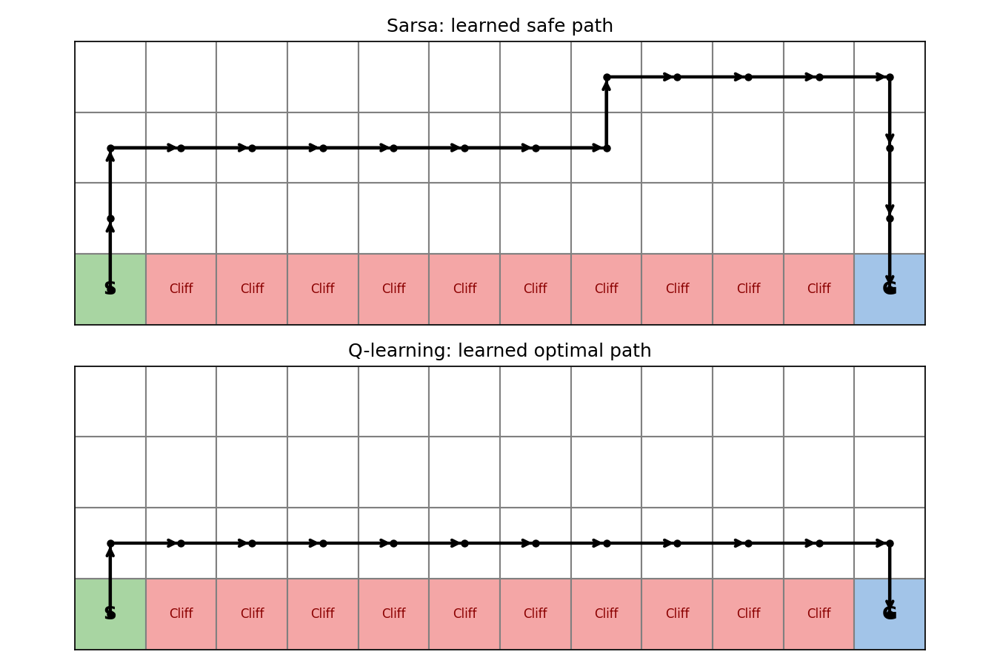
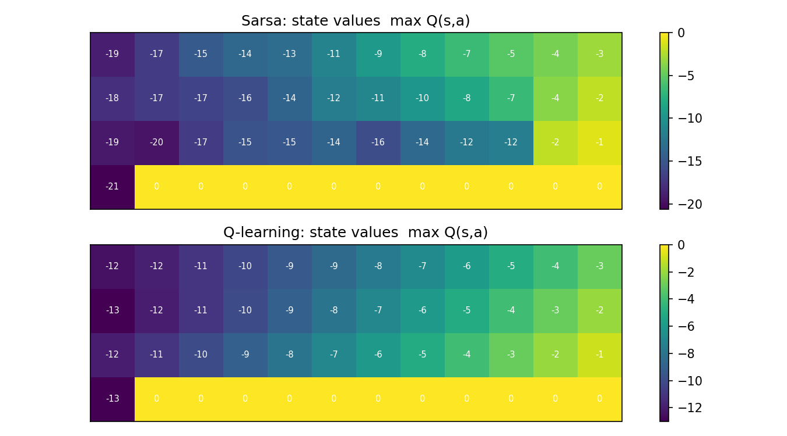

# CS656 Reinforcement Learning – Part I, Problem 8
## Cliff Walking: Sarsa vs Q-learning (Sutton & Barto, Example 6.6)

### Problem
A 4×12 gridworld. Each step gives reward -1. Stepping into the cliff gives
-100 and returns the agent to the start. Both algorithms use ε-greedy
action selection (ε = 0.1, α = 0.5, γ = 1).

### Results

| Method | Avg reward (last 100 episodes) | Learned path |
|---|---|---|
| Sarsa | about -27 | Safe, upper route |
| Q-learning | about -50 | Optimal, cliff edge |

### Learned paths and values

### How to run
Open `cliff_walking.ipynb` in Google Colab and run all cells.

### Conclusion
Q-learning (off-policy) learns the optimal path but performs worse online
because ε-greedy exploration sometimes pushes it off the cliff. Sarsa
(on-policy) accounts for exploration and learns the safer path.
